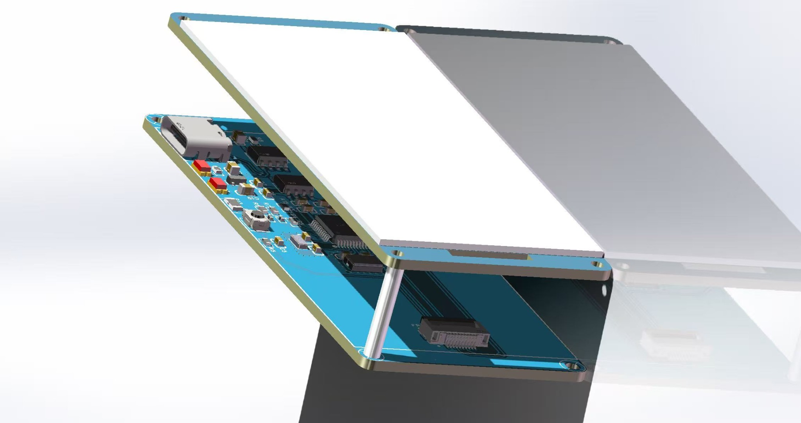

# 墨水屏摆件 · 硬件与结构

项目主体是已有的多功能墨水屏桌面摆件。板级设计渲染对应实物外观：屏幕为主要显示面，电路板位于其下方，由支撑件固定。

## 当前资料范围

- 真实设备运行演示：用于记录实际屏幕效果。
- 电路板渲染：用于展示板级外观与装配关系。
- 三张整机功能渲染：在电路板结构上加入白色微透塑料外壳，展示课程 / 日程、AI 额度和训练清单。

  

[查看实机动态演示](../assets/gifs/inkscreen-demo.gif) · [查看三种功能页面](../README.md#三种桌面信息页面) · [全部展示素材](../assets/README.md)

板级图为设计渲染；整机功能图展示外壳与页面方案，制造及功能验证进度以实际工程记录为准。

## 工程与测量

当前未收录可编辑硬件工程、原理图、BOM、机械源文件或实物固件。主控型号、屏幕物理尺寸、分辨率、供电与引脚应以之后归档的实际资料为准，不能由通用编辑器预设反推。

“超低功耗”是项目设计方向；还需整理休眠、刷新及联网等状态下的电流、电压、持续时间与测量条件，才能给出可比较的功耗或续航结论。

## 与编辑器的关系

[InkScreen Studio](../tools/inkscreen-studio/) 是独立的通用界面制作工具。现有实物界面不是用该工具生成的。后续适配时应先核对显示缓冲区格式，再验证传输与刷新流程。
